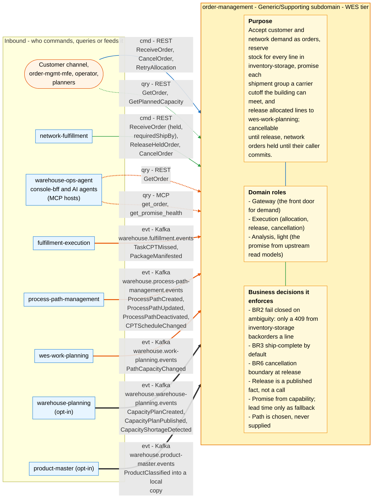
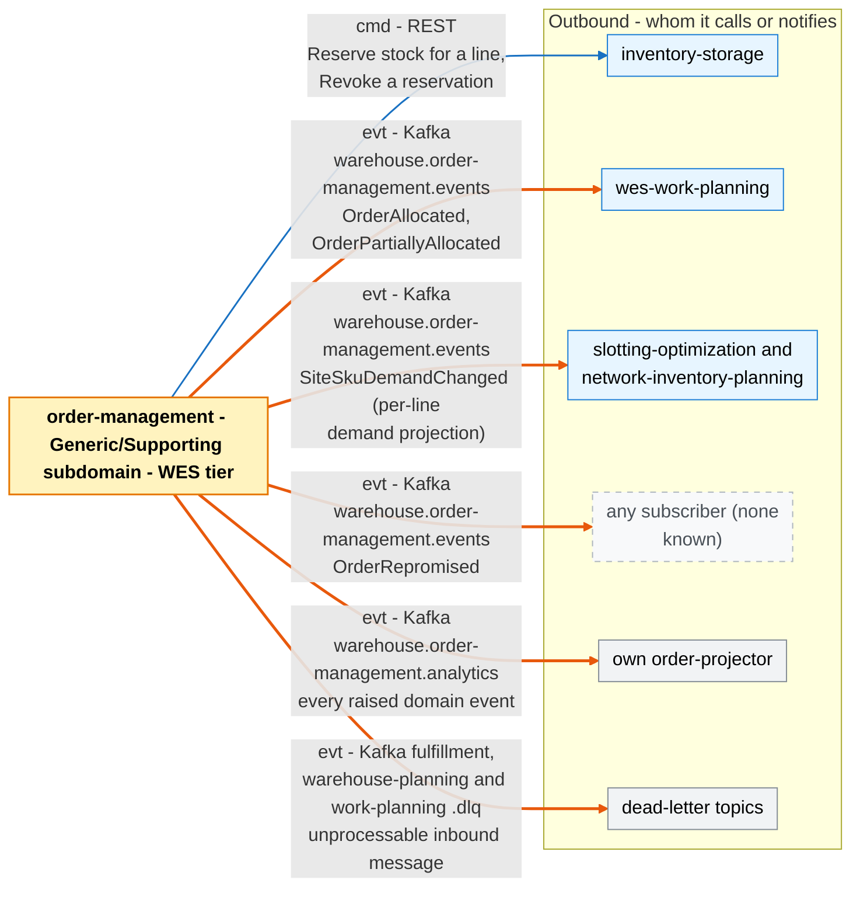

# Bounded Context Canvas

Follows the
[ddd-crew Bounded Context Canvas v5](https://github.com/ddd-crew/bounded-context-canvas).
Every message row maps to a real REST route
(`internal/adapters/inbound/http/server.go`), MCP tool
(`internal/adapters/inbound/mcp`) or Kafka topic and CloudEvents type
(the publishers in `internal/adapters/outbound/kafka`, the consumers listed
under Inbound Communication).

## Canvas at a glance

Two pictures of the sections below, laid out like the ddd-crew canvas:
first the inbound collaborators feeding this context (purpose, domain roles
and the business decisions it enforces), then the outbound collaborators it
calls or notifies. Arrows follow the message type: **solid blue**
commands (`cmd`), **dotted green** queries (`qry`), **thick orange** events
(`evt`); each arrow names its channel and the messages it carries. Box shapes
mark the collaborator kind: rounded = people, UI or any client; blue =
sibling bounded context; double border = external system or platform;
grey = this context's own projector, reports or dead-letter path; dashed =
published today with no consumer. Channel names on the arrows are
abbreviated (REST, MCP, Kafka, HTTP, port); the Inbound and Outbound
Communication tables carry the exact route, tool, topic and CloudEvents
type for every message.

### Inbound

### Outbound

Source: the Inbound Communication and Outbound Communication tables of this
page, which map to `internal/adapters/inbound/{http,kafka,mcp}` and `internal/adapters/outbound/`. The diagram omits assumptions, verification metrics, open
questions and the ubiquitous language (sections below), the relationship
pattern per message (OHS, ACL, Conformist, Customer/Supplier - see the
tables) and anything the tables mark as deprecated or platform-only
(health probes).

## Name

**Order Management** (`order-management`). CloudEvents source
`/warehouse/order-management`, type prefix
`com.warehouse.wes.order-management.order.`.

## Purpose

Accept customer and network demand as orders, reserve stock for every line
in inventory-storage, promise each shipment group a carrier cutoff the
building can actually meet, and release allocated lines to
wes-work-planning — while keeping the order cancellable until release and
holding network-originated orders until their caller commits.

## Strategic Classification

| Dimension | Value |
| --- | --- |
| Domain | **Generic/Supporting** — see [Core Domain Chart](./core-domain-chart.md) and [Subdomain Classification](./subdomain-classification.md) |
| Business Model | **Compliance / engagement enabler** — no revenue of its own; makes the fulfillment promise to the customer that the Core contexts then keep |
| Evolution | Intake: commodity. Allocation and hold/release: product. Capability-derived promise, multi-path routing, re-promise: custom |

## Domain Roles

- **Gateway** — the platform's front door for demand (`POST /orders`),
  for both direct callers and network-fulfillment.
- **Execution** — runs allocation, release and cancellation against
  inventory-storage and announces released work.
- **Analysis (light)** — computes the delivery promise from upstream
  capability, schedule and capacity read models, and publishes an
  analytics event stream for its own funnel projector.

## Inbound Communication

| Collaborator | Message | Type | Channel | Relationship |
| --- | --- | --- | --- | --- |
| Customer channel, order-mgmt-mfe | ReceiveOrder | Command | REST `POST /orders` (Idempotency-Key with Postgres) | Open Host Service |
| network-fulfillment | ReceiveOrder held, with `requiredShipBy` | Command | REST `POST /orders` | Customer/Supplier (OM supplier) |
| network-fulfillment | ReleaseHeldOrder | Command | REST `POST /orders/{id}/release` | Customer/Supplier |
| network-fulfillment, order-mgmt-mfe | CancelOrder | Command | REST `DELETE /orders/{id}` | Open Host Service |
| Operator | RetryAllocation | Command | REST `POST /orders/{id}/retry-allocation` | Open Host Service |
| warehouse-ops-agent console-bff, order-mgmt-mfe | GetOrder | Query | REST `GET /orders/{id}` | Open Host Service, Conformist downstream |
| AI agents (MCP hosts) | get_order | Query | MCP tool `get_order` (`cmd/mcp`) | Open Host Service |
| AI agents (MCP hosts) | get_promise_health | Query | MCP tool `get_promise_health` (`cmd/mcp`, reads the analytics DB) | Open Host Service |
| Planners | GetPlannedCapacity | Query | REST `GET /planned-capacity?site=&from=` | Open Host Service |
| fulfillment-execution | TaskCPTMissed | Event | Kafka `warehouse.fulfillment.events`, `com.warehouse.wes.fulfillment-execution.task.TaskCPTMissed` | Published Language, ACL |
| fulfillment-execution | PackageManifested | Event | Kafka `warehouse.fulfillment.events`, `com.warehouse.wes.fulfillment-execution.package.PackageManifested` | Published Language, ACL |
| process-path-management | ProcessPathCreated, ProcessPathUpdated, ProcessPathDeactivated | Event | Kafka `warehouse.process-path-management.events`, `com.warehouse.wes.process-path-management.processpath.*` | Published Language, ACL |
| process-path-management | CPTScheduleChanged | Event | Kafka `warehouse.process-path-management.events`, `com.warehouse.wes.process-path-management.cptschedule.CPTScheduleChanged` | Published Language, ACL |
| wes-work-planning | PathCapacityChanged | Event | Kafka `warehouse.work-planning.events`, `com.warehouse.wes.work-planning.workpool.PathCapacityChanged` | Published Language, ACL |
| wes-work-planning | WorkUnitCreated | Event | Kafka `warehouse.work-planning.events`, `com.warehouse.wes.work-planning.workunit.WorkUnitCreated`; only the optional `reference` and `line_no` are read, to confirm a released order line (opt-in `RELEASE_CONFIRMATION_MODE=kafka`, ADR 0043; available, off by default) | Published Language, ACL |
| warehouse-planning | CapacityPlanCreated, CapacityPlanPublished, CapacityShortageDetected | Event | Kafka `warehouse.warehouse-planning.events`, `com.warehouse.wes.warehouse-planning.capacityplan.*` (opt-in) | Published Language, ACL |
| product-master | ProductClassified | Event | Kafka `warehouse.product-master.events`, `com.warehouse.wms.product-master.product.ProductClassified` → local copy read at intake (opt-in `PRODUCT_CLASSIFICATION_MODE=kafka`, ADR 0036, fail-open for unknown SKUs) | Published Language, ACL (local copy) |

## Outbound Communication

| Collaborator | Message | Type | Channel | Relationship |
| --- | --- | --- | --- | --- |
| inventory-storage | Reserve stock for a line | Command | REST `POST /reservations` (body `sku`, `quantity`, `demandRef` and the optional `lineNo` so inventory-storage can confirm a pick per line — decision 18, ADR 0037; Idempotency-Key, ADR 0028) | Customer/Supplier, ACL |
| inventory-storage | Revoke a reservation | Command | REST `DELETE /reservations/{id}` | Customer/Supplier, ACL |
| wes-work-planning | OrderAllocated | Event | Kafka `warehouse.order-management.events`, `com.warehouse.wes.order-management.order.OrderAllocated` | Published Language |
| wes-work-planning | OrderPartiallyAllocated | Event | Kafka `warehouse.order-management.events`, `com.warehouse.wes.order-management.order.OrderPartiallyAllocated` | Published Language |
| slotting-optimization, network-inventory-planning | SiteSkuDemandChanged | Event | Kafka `warehouse.order-management.events`, `com.warehouse.wes.order-management.siteskudemand.SiteSkuDemandChanged` (per-line demand projection, [ADR 0035](/docs/adr/0035-site-sku-demand-projection-event)) | Published Language |
| any subscriber (none known) | OrderRepromised | Event | Kafka `warehouse.order-management.events`, `com.warehouse.wes.order-management.order.OrderRepromised` | Published Language |
| order-projector (this repo) | every raised domain event | Event | Kafka `warehouse.order-management.analytics`, `com.warehouse.wes.order-management.order.*` (including the analytics-only `OrderReleaseUnconfirmed`, ADR 0043, which the projector ignores) | internal |
| Dead-letter topics | unprocessable inbound message | Event | Kafka `warehouse.fulfillment.events.dlq`, `warehouse.warehouse-planning.events.dlq`, and (ADR 0043, when the release-confirmation consumer is on) `warehouse.work-planning.events.dlq` | internal |

## Ubiquitous Language

Full glossary: [Ubiquitous Language](/docs/business-context/ubiquitous-language).
Top terms:

| Term | Meaning |
| --- | --- |
| Order / Order line | The aggregate and its entity (`order.Order`, `order.OrderLine`) |
| Allocation | Reserving stock for a line in inventory-storage |
| Backordered | A line inventory-storage answered `409` for |
| Release | Marking allocated lines `Released` and announcing them on Kafka |
| Release confirmation | Knowing that wes-work-planning admitted a released line: `PENDING` -> `CONFIRMED` by its `WorkUnitCreated`, or `UNCONFIRMED` after `RELEASE_CONFIRMATION_TIMEOUT` (ADR 0043; off by default) |
| Ship-complete | Release nothing until every line is allocated (BR3) |
| Held order | Allocated but waiting for `POST /orders/{id}/release` (ADR 0020) |
| Promise / promise group | The CPT window a shipment group is promised to leave by |
| Promise basis | `Capability`, `LeadTime` or `Network` |
| Process path | The building workflow a line is routed to (`PathSelectionPolicy`) |

## Business Decisions

- **BR2 — fail closed on ambiguity.** Only inventory-storage's `409`
  backorders a line; any other failure aborts the allocation pass (ADR 0003).
- **BR3 — ship-complete by default.** `allowPartialShipment` defaults to
  `false`; a ship-complete order releases nothing while a line is
  unallocated (ADR 0003).
- **BR6 — cancellation boundary at release.** No cancel once any line is
  `Released`; released work is not clawed back (ADR 0004).
- **Release is a published fact, not a call** (ADR 0005).
- **A release confirmation is observed, never enforced** (ADR 0043). With
  `RELEASE_CONFIRMATION_MODE=kafka`, a released line that wes-work-planning
  never confirms is flagged `UNCONFIRMED` and announced as the analytics-only
  `OrderReleaseUnconfirmed`; the order's status is untouched and nothing is
  cancelled, re-released or retried.
- **Promise from capability** — CPT schedule, path cycle time and capacity,
  per shipment group; lead time only as fallback (ADR 0014, 0017).
- **Path is chosen, never supplied** — shortest known cycle time among
  eligible active paths, `pick` as fallback (ADR 0013, 0016, 0021).
- **Held orders must be ship-complete** (ADR 0020).
- **Reservations are reconfirmed before release**; a lapsed one becomes a
  backorder.
- **Planned capacity annotates, never moves, a promise** (ADR 0031).

## Assumptions

- inventory-storage is the single source of truth for stock; this context
  never caches stock levels.
- product-master is the single source of truth for product classification;
  this context keeps a version-guarded local copy of its
  `ProductClassified` events and never calls it. The copy is eventually
  consistent, so a SKU it has not seen yet fails open (ADR 0036).
- One deployment serves many sites by the order's own `fulfillmentSiteId`
  (ADR 0047): the promise reads that site's CPT schedule and the
  planned-capacity annotation matches it. An order without one uses
  `DEFAULT_SITE_ID` (promise) and `PLANNED_CAPACITY_SITE_ID` (annotation,
  defaulting to the same value). Path capacity and cycle time stay per path.
- wes-work-planning accepts every released line. There is no dedicated reply
  event; by default nothing confirms it, and with
  `RELEASE_CONFIRMATION_MODE=kafka` (ADR 0043, off by default) its
  `WorkUnitCreated` is the confirmation.
- Upstream catalogue, CPT-schedule and capacity topics are replayable from
  the first offset (local caches rebuild on every start).
- REST and MCP are unauthenticated (ADR 0012); network-level controls are
  outside this repo.

## Verification Metrics

| Metric | Where |
| --- | --- |
| Orders accepted vs rejected at intake | `ports.OrderMetrics` (`internal/adapters/outbound/telemetry`) |
| Funnel: received, allocated, partially allocated, failed, cancelled, backordered lines | `funnel_rollup` via `cmd/order-projector`, [Order Funnel report](/docs/analytics/order-funnel-report) |
| Promise basis mix, split shipments, promise-to-cutoff gap | `funnel_rollup` (ADR 0019), MCP `get_promise_health` |
| Re-promises per hour | `repromise_rollup` |
| Outbox lag | `order.outbox.lag_seconds` gauge (ADR 0032) |
| Release confirmation (only with `RELEASE_CONFIRMATION_MODE=kafka`) | `order.release_confirmation.events` (by `outcome`) and `order.release_confirmation.unconfirmed` counters (`telemetry/release_confirmation_metrics.go`, ADR 0043) |

## Open Questions

- No consumer of `OrderRepromised` on the integration topic is known — does
  wes-work-planning or network-fulfillment need it?
- **Held orders are never swept.** Nothing expires an orphaned hold; ADR
  0020 names network-fulfillment as the natural owner of a sweeper.
- Release confirmation (ADR 0043) is available but off by default, and a line
  it flags `UNCONFIRMED` is only reported. Whether an automatic reaction
  (re-publishing `OrderAllocated`, revoking reservations, cancelling) is ever
  wanted is open and needs its own ADR.
