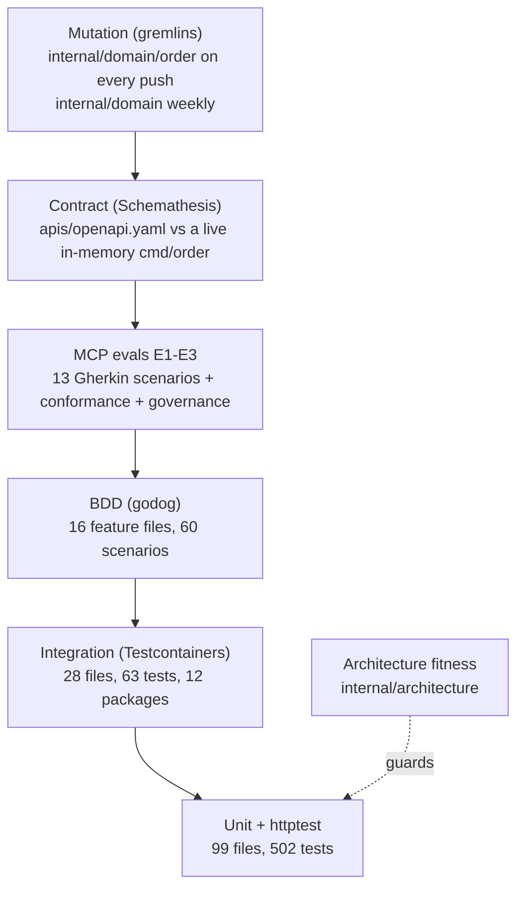

# Testing

Every layer below exists in the repository today. Counts were taken from
the `develop` tree on 2026-10-12 (`func Test…` declarations, Gherkin
`Scenario:` headings); they drift as tests are added.

Source: `features/*.feature`, `**/*_test.go`, `.github/workflows/ci.yml`, `Makefile`.

## Make targets

| Target | Command | Needs |
| --- | --- | --- |
| `make test` | `go test ./... -race` | Go only |
| `make coverage` | `go test ./... -race -coverprofile=coverage.out -coverpkg=./internal/domain/...,./internal/application/...` and the **90 %** gate on the total | Go only |
| `make bdd` | `go test ./... -run TestFeatures -v` | Go only |
| `make arch-test` | `go test ./internal/architecture/... -v` | Go only |
| `make integration` | `go vet -tags=integration ./...` then `go test -tags=integration ./... -race -count=1` | Docker (each test starts its own containers) |
| `make contract` | `./scripts/contract-test.sh` | `st` from `schemathesis==4.28.0`, a free port (default `18084`) |
| `make mutation-fast` | `gremlins unleash ./internal/domain/order` | `gremlins` v0.6.0 |
| `make mutation` | `gremlins unleash ./internal/domain --workers 1 --timeout-coefficient 30` | `gremlins` v0.6.0; slow |
| `make vuln` | `govulncheck ./...` | `govulncheck` |
| `make check` | `fmt-check vet build lint test` | `golangci-lint` v2.13.1 |
| `make check-all` | `check coverage arch-test bdd` | as above |
| `make check-fast` | `fmt-check vet arch-test` plus the tests of packages changed against `HEAD` | used by the agent Stop hook |
| `make guide-lint`, `make harness-test` | `scripts/harness/guide_lint.py`, `scripts/harness/test_hook.py` | Python 3 |

`lefthook.yml` runs `make fmt-check`, `make vet` and `make lint` before
each commit and `make check` before each push, once a clone has run
`lefthook install`.

## Unit tests

- Domain (`internal/domain/order`, `processpath`, `shared`): the
  aggregate, line state machine, status derivation, promise policy and
  promise groups, path selection and eligibility, planned-capacity
  windows. Pure Go, no fakes needed.
- Application (`internal/application/usecases`): every use case against
  in-memory repositories and the fakes in `fakes_test.go` (inventory
  client, publisher, metrics counter, clock).
- Adapters: the HTTP router through `httptest` (status codes, problem
  types, idempotency, readiness, logging), the Kafka consumers against
  fake readers and DLQ writers, the publishers against fake writers, the
  inventory-storage client against a fake `HTTPDoer`, the circuit
  breaker, the telemetry instruments, the composition root's wiring
  helpers in `cmd/order`.
- Golden files pin wire formats: `internal/adapters/outbound/kafka`
  (`cloudevents_golden_test.go`), `internal/adapters/outbound/events/testdata/log_payloads.golden`,
  `internal/adapters/inbound/mcp/testdata/tool_registry.golden` and
  `fleet_tool_snapshot.golden`.

Coverage is measured on `internal/domain/...` and
`internal/application/...` only, and must stay at or above 90 %.

## Integration tests (`-tags=integration`)

Every suite starts its own throwaway container with testcontainers-go
v0.44.0 (`postgres` and `kafka` modules). There is no shared
`DATABASE_URL`, no `t.Skip` on a missing environment variable, and no
`localhost:9092`: the architecture fitness tests below fail the build if
one appears. Postgres packages migrate once into a template database and
clone one database per test.

| Package | Files | What it proves |
| --- | --- | --- |
| `cmd/order` | 1 | The housekeeping sweeper wiring against real Postgres. |
| `internal/adapters/inbound/http` | 2 | The `Idempotency-Key` middleware and the router over real Postgres. |
| `internal/adapters/inbound/kafka` | 6 | Re-promise consumer end to end, its version-conflict retry, its DLQ (including auto-creating a missing `.dlq` topic), the planned-capacity and product-classification consumers. |
| `internal/adapters/inbound/mcp` | 1 | initialize, `tools/list` and `tools/call` over the real Streamable HTTP transport, with real Postgres (OLTP and analytics) behind it. |
| `internal/adapters/outbound/analyticsstore` | 2 | Projection and report queries. |
| `internal/adapters/outbound/kafka` | 1 | Publisher on a real broker, CloudEvents envelope asserted. |
| `internal/adapters/outbound/kafkacatalog`, `kafkacptschedule`, `kafkapathcapacity` | 2, 1, 1 | The replay caches, including two catalogue consumers side by side. |
| `internal/adapters/outbound/postgres` | 9 | Order repository and version column, outbox and relay, outbox lag gauge, release events through the outbox, planned capacity, pool limits (`MaxConns`, `statement_timeout`), sweeper. |
| `internal/adapters/outbound/productclassificationcopy` | 1 | The Postgres copy and its version guard. |
| `internal/application/usecases` | 1 | Receive, allocate, release, retry, cancel against the real repository and UnitOfWork. |

The CI job and `make integration` both use `./...`.
`TestEveryIntegrationPackageRunsInCI` fails if a package with a
`//go:build integration` file is not reached by an integration command in
`ci.yml`. In CI, `TESTCONTAINERS_RYUK_DISABLED=true` is set because the
parallel test processes contend for the reaper.

## BDD (godog)

`TestFeatures` (`features_test.go` at the repo root) runs every file in
`features/` with `Strict: true`, so an undefined or pending step fails
the suite. Step definitions live in `features_test.go`,
`features_planned_capacity_test.go` and `features_wave2_test.go`. The
scenarios drive the use cases, and for the REST contract scenarios the
router through `httptest`, all on in-memory adapters.

| Feature file | Scenarios |
| --- | --- |
| `allocation_events.feature` | 5 |
| `allocation_failure.feature` | 2 |
| `api_contract.feature` | 8 |
| `cancellation.feature` | 2 |
| `cancellation_extended.feature` | 2 |
| `domain_events.feature` | 2 |
| `error_paths.feature` | 4 |
| `held_orders.feature` | 5 |
| `held_orders_extended.feature` | 3 |
| `intake_validation.feature` | 4 |
| `order_lifecycle.feature` | 2 |
| `partial_shipment.feature` | 2 |
| `planned_capacity.feature` | 10 |
| `planned_capacity_extended.feature` | 5 |
| `required_ship_by.feature` | 2 |
| `ship_complete.feature` | 2 |
| **16 files** | **60** |

## Contract tests (Schemathesis)

`scripts/contract-test.sh` builds `cmd/order`, starts it in memory on
`127.0.0.1:${CONTRACT_PORT:-18084}` with
`PLANNED_CAPACITY_CONSUMER_GROUP=contract-test-planned-capacity` and
`PLANNED_CAPACITY_SITE_ID=SIM1` (so `GET /planned-capacity` exists), waits
for `/healthz`, then runs Schemathesis 4.28.0 with
`CONTRACT_MAX_EXAMPLES` (default 100) examples per operation against
`apis/openapi.yaml`. `receiveOrder` is excluded, because the "held order
must be ship-complete" rule links two booleans in a way OpenAPI 3.0 cannot
express; the BDD scenario and the domain unit test cover it instead.

## Mutation testing (gremlins)

Thresholds live in `.gremlins.yaml`: **efficacy 97**, **mutant-coverage
99**, with `workers: 1` and `timeout-coefficient: 30`. gremlins fails when
the measured value is less than or equal to the threshold. The last
recorded run (2026-10-10, `./internal/domain/order`) measured 137 killed,
3 lived, 1 not covered: efficacy 97.86 %, mutant coverage 99.29 %. The
three survivors are listed as accepted near-equivalents in the README.

## Architecture fitness tests (`internal/architecture`)

| Test | Rule |
| --- | --- |
| `TestHexagonalDependencyRule` | domain imports nothing internal; application imports only domain; inbound and outbound adapters never import each other; only `cmd/` wires every layer. |
| `TestAnalyticsIsolation` | `internal/analytics` never imports the OLTP layers (ADR 0006). |
| `TestPortsAreCustomerOwned` | `internal/application/ports` never imports an adapter or `cmd/` (ADR 0002). |
| `TestMCPAdapterDependencyRule` | the MCP adapter depends only on application and domain, and nothing else imports it. |
| `TestNoAuthMiddlewareReintroduced` | no bearer-auth middleware comes back (ADR 0012). |
| `TestKafkaConsumerGroupNeverHardcodedInline` | consumer groups are named constants or configuration. |
| `TestKafkaIntegrationTestsUseTestcontainers`, `TestPostgresIntegrationTestsUseTestcontainers` | no env-gated or `localhost:9092` integration tests. |
| `TestDomainHasNoSerializationTags` | no `json:` tags in `internal/domain`. |
| `TestCloudEventsOnly`, `TestReplayConsumersSetCommitInterval` | every Kafka message goes through the CloudEvents helper; replay readers set `CommitInterval`. |
| `TestEventCatalogueMatchesContract` | every CloudEvents type `apis/asyncapi.yaml` declares for this service also appears in an ADR (the event catalogue). |
| `TestEveryIntegrationPackageRunsInCI` | see above. |

Several sensors have a companion test (`TestPostgresIntegrationDetector`,
`TestEventCatalogueDetector`, `TestDomainTagSensorFailsOnBadFixtures`,
`TestIntegrationCoverageSensorFailsOnBadFixtures`) that proves the sensor
flags a known-bad fixture.

## MCP evals (`internal/adapters/inbound/mcp`)

| Level | Tests | What |
| --- | --- | --- |
| E1 governance | `TestEval_InputSchemasResolveAndConstrain`, `TestEval_ParametersAreDescribed`, `TestEval_ToolRegistryMatchesGolden`, `TestEval_FleetToolNamesAreGloballyUnique` | Schemas resolve, every parameter has a description, the registry matches `tool_registry.golden`, tool names are unique across the fleet snapshot. |
| E2 conformance | nine `TestEvalConformance_*` tests | Handshake, unknown tool, wrong-typed and extra arguments, no resources or prompts advertised, session close. |
| E3 behaviour | `TestMCPEvalSuite` | 13 scenarios in `testdata/features/mcp_tools.feature`, run through godog with `Strict: true`. |

## Frontend (`web/`)

Vitest tests (`src/config.test.ts`, `src/screens/OrderManagementScreen.test.tsx`
with an MSW mock server) run in the `web` CI job together with lint,
`tsc -b` and the production build. They are not part of `make check`.

The chart has a selector test, `python3
charts/order-management/tests/test_service_selectors.py`, which proves
each Service selects exactly one Deployment. No CI job runs it.

## CI jobs (`.github/workflows/ci.yml`)

| Job | Runs | When |
| --- | --- | --- |
| `lint` | golangci-lint v2.13.1 | every push and PR |
| `guide-lint` | `guide_lint.py`, `repo_lint.py`, `test_hook.py`, `test_repo_lint.py` | every push and PR |
| `complexity` | golangci-lint with only gocyclo, gocognit, cyclop, funlen, nestif; gocyclo > 10 report | every push and PR |
| `test` | build, vet, gofmt, `go test ./... -race` with coverage, 90 % gate | every push and PR |
| `bdd` | `go test ./... -run TestFeatures -v` | every push and PR |
| `contract` | `scripts/contract-test.sh` | every push and PR |
| `evals-tests` | `go test ./internal/adapters/inbound/mcp/... -race -run '^TestEval\|^TestMCPEvalSuite' -v` | every push and PR |
| `integration` | `go vet -tags=integration ./...`, `go test -tags=integration ./... -race -count=1` | every push and PR |
| `mutation-fast` | `gremlins unleash ./internal/domain/order` | every push and PR |
| `vuln` | govulncheck v1.8.0 | every push and PR |
| `api-lint` | Spectral on `apis/openapi.yaml` and `apis/asyncapi.yaml` | every push and PR |
| `arch-test` | `go test ./internal/architecture/... -v` | every push and PR |
| `docs-api-drift` | regenerates `docs/docs/api-reference/rest` and fails on any change | every push and PR |
| `web` | MFE lint, typecheck, test, build | every push and PR |
| `mutation` | full-domain gremlins; opens or closes a `harness:red` issue | schedule (Mondays 06:00 UTC) and manual dispatch |
| `drift` | deadcode, `go mod tidy -diff`, knip, coverage quality | schedule and manual dispatch |
| `helm-lint`, `trivy-scan` | chart-testing lint; image scan | PRs into `main` only |
| `docker-publish`, `release` | push the image, tag, chart and GitHub release | pushes to `main` only |

The documentation site is built by `.github/workflows/docs.yml` only on
pushes to `main`. A docs change in a PR is not built by CI: run
`npm ci` and `npm run build` in `docs/` yourself.
