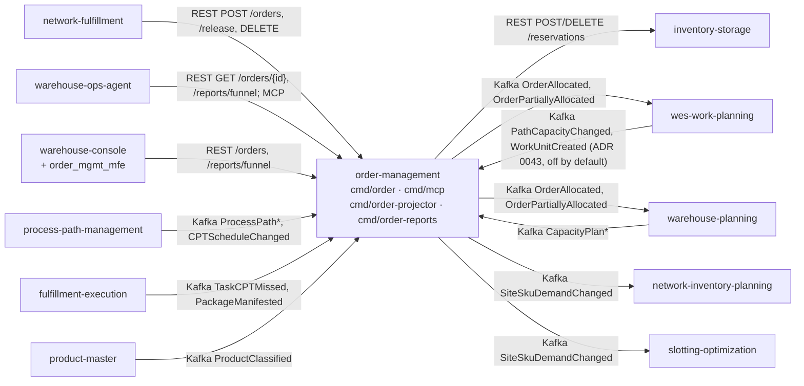

# Integration contracts

This page lists every system that talks to order-management or that
order-management talks to, with the exact contract and the failure
behaviour coded on this side. For the DDD reading of the same edges
(Customer/Supplier, Open Host Service, Anti-Corruption Layer), see the
[Context Map](./context-map.md).

Consumers in sibling repositories were checked with `git grep` on each
sibling's `origin/develop` in the local checkouts on 2026-10-12.

Source: `cmd/order/*.go`, `internal/adapters/inbound/kafka/*.go`, `internal/adapters/outbound/kafka/publisher.go`, `internal/adapters/outbound/inventorystorage/client.go`.

## Inbound: callers of this service

All REST and MCP endpoints are unauthenticated. In the kind cluster the
REST API is behind Kong at `/api/order-management` (prefix stripped).

| Caller | Protocol | Contract | Failure behaviour on this side |
| --- | --- | --- | --- |
| network-fulfillment | REST, `ORDER_MANAGEMENT_URL` (`http://order-management.<ns>.svc.cluster.local:80`) | `POST /orders` with `releaseOnAllocation: false` and `requiredShipBy` (ADR 0020), `POST /orders/{id}/releases`, `DELETE /orders/{id}` | `POST /orders` needs an `Idempotency-Key` (400 without it, 422 when reused with another body). A held order that allows partial shipment is 422. A deadline that cannot be met answers 201 with no `promiseDate`. The caller wraps this service in its own circuit breaker. |
| warehouse-ops-agent | REST `ORDER_MANAGEMENT_REST_URL`, reports REST `ORDER_MANAGEMENT_REPORTS_REST_URL`, MCP `ORDER_MANAGEMENT_MCP_ENDPOINT` | `GET /orders/{id}`; `GET /reports/funnel`, `GET /reports/funnel/freshness`; MCP tools `get_order`, `get_promise_health` | Read-only. Unknown ids are 404 (`order-not-found`) over REST and a tool error `order not found` over MCP. |
| warehouse-console (shell) and `order_mgmt_mfe` (`web/`) | REST from the browser | The MFE uses `POST /orders`, `GET /orders/{id}` and the other order routes; the shell's context-reports page uses `GET /reports/funnel` and `/freshness` | CORS allows `CORS_ALLOWED_ORIGINS` with headers `Content-Type`, `Authorization` and `Idempotency-Key`. The MFE sends one `Idempotency-Key` (a `crypto.randomUUID()`) per order submission, reused when the request got no answer and replaced after an answer or a form edit (ADR 0038). |
| fulfillment-execution | Kafka, `warehouse.fulfillment.events`, group `order-management-repromise` | `com.warehouse.wes.fulfillment-execution.task.TaskCPTMissed`, `com.warehouse.wes.fulfillment-execution.package.PackageManifested`; every other type on the topic is skipped | Drives `RepromiseOrder` once per CloudEvents id. Non-CloudEvents messages and messages still failing after 3 attempts go to `warehouse.fulfillment.events.dlq`. Off when `KAFKA_BROKERS` is unset. |
| process-path-management | Kafka, `warehouse.process-path-management.events`, per-process replay groups | `com.warehouse.wes.process-path-management.processpath.ProcessPathCreated`, `…ProcessPathUpdated`, `…ProcessPathDeactivated`; `com.warehouse.wes.process-path-management.cptschedule.CPTScheduleChanged` | Only with `PATH_CATALOGUE_SOURCE=kafka`. Boot waits up to 60 s per cache and fails if the replay does not finish. Without the caches: no path validation and lead-time promises only. Reads `path_id`, `match_prefix`, `cycle_time_p95`, `eligibility`, `destination_location_role` and `intake` (process-path-management ADR 0034; absent = empty): path selection considers only paths whose intake contains `CUSTOMER_ORDER` and falls back to `pick` when none does ([ADR 0042](../adr/0042-path-selection-honours-process-path-intake.md)). |
| wes-work-planning | Kafka, `warehouse.work-planning.events`, per-process replay group | `com.warehouse.wes.work-planning.workpool.PathCapacityChanged` | Same switch and boot wait as above. Without it, path capacity is `Unknown`. |
| wes-work-planning (release confirmation) | Kafka, `warehouse.work-planning.events`, group `RELEASE_CONFIRMATION_CONSUMER_GROUP` (stable, no default) | `com.warehouse.wes.work-planning.workunit.WorkUnitCreated`; reads only the optional `data.reference` (the order id) and `data.line_no` | Available, **off by default**: runs only with `RELEASE_CONFIRMATION_MODE=kafka` (ADR 0043). Confirms the released line `{reference}`/`{line_no}` once per CloudEvents id. An event without both fields, or for a line this service never released (transfer, RELOCATE, legacy work), is ignored and counted, not dead-lettered. An undecodable `data`, a non-CloudEvents message or a handling that still fails after 3 attempts goes to `warehouse.work-planning.events.dlq`. Needs wes-work-planning to stamp the two fields (its ADR 0041); until it does, every line is flagged after the timeout, so do not enable the mode before that is deployed. |
| warehouse-planning | Kafka, `warehouse.warehouse-planning.events`, group `PLANNED_CAPACITY_CONSUMER_GROUP` | `com.warehouse.wes.warehouse-planning.capacityplan.CapacityPlanCreated`, `…CapacityPlanPublished`, `…CapacityShortageDetected`, `…BottleneckDetected` | Opt-in (ADR 0031). Annotates orders only; never moves a promise or rejects an order. Bad messages go to `warehouse.warehouse-planning.events.dlq`. A failing read model omits the annotation and the order read still succeeds. |
| product-master | Kafka, `warehouse.product-master.events`, group `PRODUCT_CLASSIFICATION_CONSUMER_GROUP` | `com.warehouse.wms.product-master.product.ProductClassified` | Opt-in (ADR 0036). Unknown SKUs fail open (no attributes). Invalid messages are logged and skipped; transient errors retry the same message. |

## Outbound: what this service calls or publishes

| Target | Protocol | Contract | Failure behaviour on this side |
| --- | --- | --- | --- |
| inventory-storage | REST, `INVENTORY_STORAGE_BASE_URL`, 5 s timeout, one circuit breaker | `POST /reservations` with `Idempotency-Key: res-<orderId>-line-<lineNo>-att-<attempt>` (ADR 0028) and the line number in the body (ADR 0037); `DELETE /reservations/{id}` | `201`/`200` with an id: allocated. `409`: the line is `Backordered` (business fact). Anything else, a timeout or an open breaker: `downstream-unavailable`, the pass fails and nothing is marked backordered (BR2). `DELETE` treats `404` as success. Never retried. In `permissive` mode nothing is called and allocation refuses (`downstream-not-configured`). |
| wes-work-planning | Kafka, `warehouse.order-management.events` | `com.warehouse.wes.order-management.order.OrderAllocated`, `com.warehouse.wes.order-management.order.OrderPartiallyAllocated` | Consumed by its order consumer. Fire-and-forget by default: no reply event comes back (README "Deferred"). With `RELEASE_CONFIRMATION_MODE=kafka` (ADR 0043, off by default) the release is confirmed by the inbound `WorkUnitCreated` edge above, and a line not confirmed within `RELEASE_CONFIRMATION_TIMEOUT` is flagged with an analytics-only `OrderReleaseUnconfirmed`. Nothing is cancelled, re-released or retried. |
| warehouse-planning | Kafka, `warehouse.order-management.events` | `OrderAllocated`, `OrderPartiallyAllocated` (order demand) | Same topic, consumed independently. |
| network-inventory-planning | Kafka, `warehouse.order-management.events` | `com.warehouse.wes.order-management.siteskudemand.SiteSkuDemandChanged` | Emitted only with `DEMAND_PROJECTION_SITE_ID` set (ADR 0035). |
| slotting-optimization | Kafka, `warehouse.order-management.events` | `SiteSkuDemandChanged` | Same switch. |
| (nobody found) | Kafka, `warehouse.order-management.events` | `com.warehouse.wes.order-management.order.OrderRepromised` | Published since ADR 0018; no sibling's `develop` consumes it yet. |
| this service's projector | Kafka, `warehouse.order-management.analytics`, group `order-management-analytics` | `com.warehouse.wes.order-management.order.OrderReceived`, `…OrderAllocated`, `…OrderPartiallyAllocated`, `…OrderAllocationPartiallyFailed`, `…OrderReleased`, `…OrderCancelled`, `…OrderLineAllocated`, `…OrderLineBackordered`, `…OrderLineReleased`, `…OrderRepromised` | Internal data product (ADR 0006). The e2e-tests repository also reads both topics. The topic also carries `…OrderReleaseUnconfirmed` (ADR 0043, only with the confirmation loop on); the projector ignores that type. |

Every produced event is a CloudEvents 1.0 structured-mode message,
`source /warehouse/order-management`, `dataschema
urn:warehouse:order-management:<events|analytics>:<EventName>:v1`, keyed
by order id. Delivery is at least once (outbox relay); consumers dedupe on
the CloudEvents `id`. The payload schemas are in `apis/asyncapi.yaml` and
on [Domain Events](../ddd/domain-events.md).

## Edges that do not exist

- No synchronous call to wes-work-planning: release is the Kafka event
  (ADR 0005). By default nothing tells this service whether the work was
  created; with `RELEASE_CONFIRMATION_MODE=kafka` (ADR 0043, off by default)
  it learns only from wes-work-planning's own `WorkUnitCreated`, never from a
  call or a dedicated reply event.
- No call to product-master or process-path-management: their facts
  arrive only as events into local copies.
- No call to fulfillment-execution: re-promise is triggered only by its
  events.
- No shared database and no imported Go module from any sibling
  (ADR 0002).
- No consumer of `OrderRepromised` in the fleet yet.
- No authentication on REST or MCP (ADR 0012).
