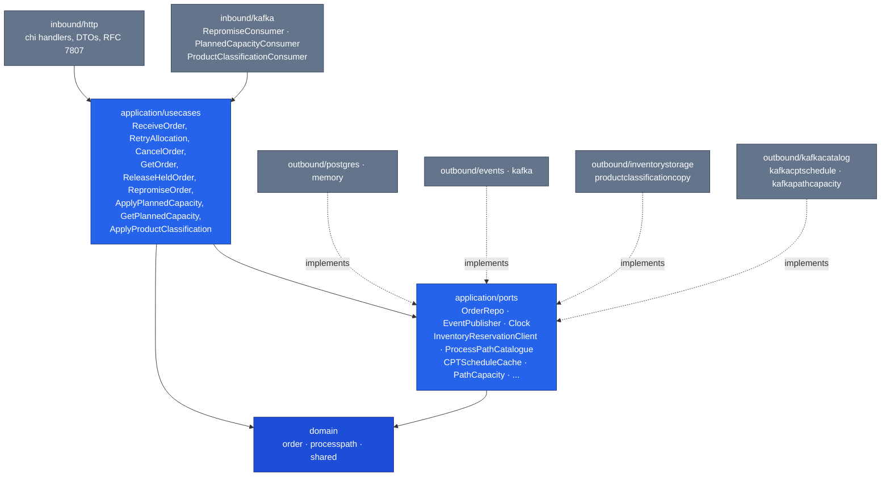
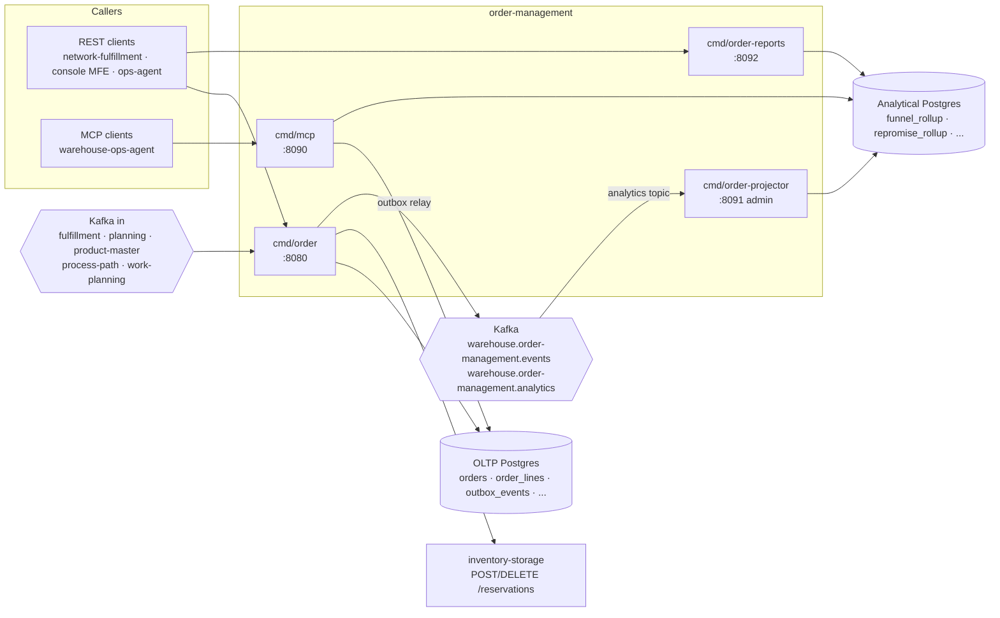

# Architecture

The service is **hexagonal (ports & adapters)** with one non-negotiable rule:

> **domain depends on nothing; application depends on domain; adapters
> depend on application/domain.**

No framework type, no `chi` router, no `pgx` connection, and no SQL string
ever appears inside `internal/domain/`.

## Layout

```text
cmd/order/                    main.go — composition root of the OLTP service
cmd/mcp/                      read-only MCP server (Streamable HTTP, ADR 0010)
cmd/order-projector/          analytics projector — Kafka -> analytics DB (ADR 0006)
cmd/order-reports/            analytics read API (order funnel report)
internal/
  domain/
    order/                    Order aggregate, OrderLine, Status, invariants,
                               PromisePolicy (+ LeadTimePolicy fallback),
                               PathSelectionPolicy
    processpath/              process-path definitions
    shared/                   value objects: OrderId, SKU, PathId, events, errors
  application/
    ports/                    OUT: OrderRepo, EventPublisher, UnitOfWork, Clock,
                               OrderMetrics, InventoryReservationClient,
                               ProcessPathCatalogue, CPTScheduleCache,
                               ProductClassificationLookup, PathCapacity,
                               RepromiseProcessedEvents, PlannedCapacityRepo,
                               PlannedCapacityProcessedEvents,
                               ProductClassificationCopy,
                               ProductClassificationProcessedEvents
    usecases/                 ReceiveOrder, RetryAllocation, CancelOrder,
                               GetOrder, ReleaseHeldOrder, RepromiseOrder,
                               ApplyPlannedCapacity, GetPlannedCapacity,
                               OrderCapacityConstraints, ApplyProductClassification
                               (allocation + release folded into allocateAndRelease)
  adapters/
    inbound/http/             chi handlers, DTOs, RFC 7807 error mapping,
                               Idempotency-Key middleware, readiness gate
    inbound/kafka/            RepromiseConsumer (warehouse.fulfillment.events),
                               PlannedCapacityConsumer (warehouse.warehouse-planning.events),
                               ProductClassificationConsumer (warehouse.product-master.events),
                               AnalyticsConsumer (cmd/order-projector)
    inbound/mcp/              MCP tools
    kafka/cloudevents/        the only CloudEvents 1.0 New/Decode helper (ADR 0030)
    outbound/inventorystorage/  HTTP client: POST /reservations,
                                 DELETE /reservations/{id}
    outbound/productclassificationcopy/  local copy of product-master classifications
                                 (Postgres / in-memory) + permissive lookup (ADR 0036)
    outbound/kafka/           integration + analytics publishers
    outbound/kafkacatalog/    process-path catalogue cache (Kafka)
    outbound/kafkacptschedule/  CPT schedule cache (Kafka)
    outbound/kafkapathcapacity/ path capacity cache (Kafka)
    outbound/pathcapacity/    "unknown capacity" default
    outbound/postgres/        pgxpool repos, transactional outbox + relay,
                               unit of work, housekeeping sweeper
    outbound/memory/          in-memory repos + clocks
    outbound/events/          log publisher (default EVENT_PUBLISHER=log)
    outbound/analyticsstore/  analytics projection + report queries
    outbound/telemetry/       OpenTelemetry metrics and traces (OTLP push)
  analytics/report/           analytical read model (depends on nothing internal)
  bootretry/, resilience/, pgtx/  boot retry, circuit breakers, tx-in-context
migrations/                   golang-migrate SQL files (+ migrations/analytics)
apis/openapi.yaml, apis/asyncapi.yaml
docs/docs/adr/                Architecture Decision Records
```

## The dependency flow



Solid arrows are compile-time imports; dashed arrows are interface
satisfaction. No arrow points from the application layer into an adapter —
the application only ever names an interface in `application/ports`, and
`cmd/order/main.go` is the only place that decides which implementation
gets plugged in. See [ADR 0001](/docs/adr/0001-hexagonal-ports-and-adapters).
The rule is enforced by `internal/architecture` (the `arch-test` CI job).

Source: `internal/architecture/architecture_test.go` (`TestHexagonalDependencyRule`) and the package imports under `internal/`.

## Deployables

One image (`Dockerfile`) builds four binaries. Each is its own composition
root and its own Deployment in `charts/order-management`.

| Binary | Role | Listens on | Inbound adapters | Stores it touches |
| --- | --- | --- | --- | --- |
| `cmd/order` | The OLTP service: order intake, allocation, release, cancellation, re-promise, planned-capacity and classification consumers, outbox relay, housekeeping sweeper | `HTTP_ADDR` `:8080` (REST, `/healthz`, `/readyz`) | `inbound/http`, `inbound/kafka` (re-promise, planned-capacity, product-classification) | OLTP Postgres (read-write, migrates), Kafka (produces both topics, consumes five) |
| `cmd/mcp` | Read-only MCP server (ADR 0010): `get_order`, `get_promise_health` | `MCP_ADDR` `:8090` (Streamable HTTP on `/*`) | `inbound/mcp` | OLTP Postgres (reads, also migrates), analytical Postgres (read-only) |
| `cmd/order-projector` | The only writer of the analytical database (ADR 0006) | `ADMIN_ADDR` `:8091` (`/healthz` only) | `inbound/kafka` (analytics consumer) | Kafka `warehouse.order-management.analytics`, analytical Postgres (read-write, migrates) |
| `cmd/order-reports` | Read-only funnel report API | `HTTP_ADDR` `:8092` (`/reports/funnel`, `/reports/funnel/freshness`, `/healthz`) | `inbound/http` (reports router) | analytical Postgres (read-only pool) |



Source: `cmd/order/main.go`, `cmd/mcp/main.go`, `cmd/order-projector/main.go`, `cmd/order-reports/main.go`.

### Data stores

| Store | Tables (migration that creates them) | Owner |
| --- | --- | --- |
| OLTP Postgres (`DATABASE_URL`) | `orders`, `order_lines` (0001), `order_promise_groups` (0003), `repromise_processed_events` (0004), `outbox_events` (0007, which also drops 0001's `events`), `idempotency_keys` (0008), `orders.version` column (0009), `planned_capacity_windows`, `planned_capacity_processed_events` (0010), `product_classification_copy`, `product_classification_processed_events` (0011) | `cmd/order` and `cmd/mcp` both apply `migrations/` at boot |
| Analytical Postgres (`ANALYTICS_DATABASE_URL`) | `analytics_processed_events`, `analytics_consumed_events`, `funnel_rollup` (`analytics/0001`), `repromise_rollup` (`analytics/0002`) | `cmd/order-projector` applies `migrations/analytics/` and is the only writer |
| In-memory | the same repositories in `outbound/memory` and `outbound/productclassificationcopy` | used when `DATABASE_URL` is unset; lost on restart |
| Per-process caches | process-path catalogue, CPT schedule, path capacity | rebuilt from Kafka on every boot when `PATH_CATALOGUE_SOURCE=kafka` |

## Ports

| Port | Responsibility | Implementations |
| --- | --- | --- |
| `OrderRepo` | Persist/retrieve `Order`; mint IDs | `postgres`, `memory` |
| `EventPublisher` | Publish a `shared.DomainEvent` | `events` (log), `postgres` (transactional outbox, ADR 0022), `kafka` (integration + analytics fan-out, direct or via the outbox relay) |
| `UnitOfWork` | Bracket a Save + Publish(es) atomically (ADR 0022) | `postgres` (real Postgres transaction), nil (pass-through) |
| `Clock` | `Now()` — makes promise computation deterministic in tests | `memory.SystemClock`, fixed clocks in tests |
| `OrderMetrics` | Order accepted/rejected counter | `telemetry` (OpenTelemetry) |
| `InventoryReservationClient` | `Reserve`/`Revoke` against inventory-storage | `outbound/inventorystorage` (http), permissive no-op |
| `ProductClassificationLookup` | Product attributes for path eligibility (ADR 0016), read from a local copy of product-master events (ADR 0036) | `outbound/productclassificationcopy` (Postgres, memory), permissive |
| `ProductClassificationCopy` | Version-guarded write side of that copy (ADR 0036) | `outbound/productclassificationcopy` (Postgres, memory) |
| `ProductClassificationProcessedEvents` | Idempotency gate for the product-classification consumer (ADR 0036) | `outbound/productclassificationcopy` (Postgres, memory) |
| `ProcessPathCatalogue` | Active paths + capability (ADR 0013/0014) | `outbound/kafkacatalog` |
| `CPTScheduleCache` | Site CPT schedule (ADR 0014) | `outbound/kafkacptschedule` |
| `PathCapacity` | Remaining path capacity per cutoff (ADR 0015) | `outbound/kafkapathcapacity`, `pathcapacity.Unknown` |
| `RepromiseProcessedEvents` | Idempotency gate for the re-promise consumer (ADR 0018) | `postgres`, `memory` |
| `PlannedCapacityRepo` | Local read model of warehouse-planning's capacity windows (ADR 0031) | `postgres`, `memory` |
| `PlannedCapacityProcessedEvents` | Idempotency gate for the planned-capacity consumer (ADR 0031) | `postgres`, `memory` |

The inventory-storage reservation client is env-selected
`INVENTORY_STORAGE_MODE=http|permissive` and the classification lookup
`PRODUCT_CLASSIFICATION_MODE=kafka|permissive` (both defaulting to
`permissive`, so unit tests never hit the network; `http` for
classification was removed by ADR 0036 and fails boot). The
classification lookup fails open like the fleet's other soft lookups; the
reservation client does not — allocation against a permissive client
returns a clear `ErrDownstreamNotConfigured` rather than a fabricated
success. Only `http` mode is suitable for a real integration test or
deployment.

## Composition root

`cmd/order/` is the composition root of the OLTP service, split by concern:
`main.go` (the startup sequence), `config.go` (env readers), `adapters.go`
(memory vs Postgres repositories and the event publisher), `kafka.go`
(publishing, outbox relay, re-promise consumer), `outbound.go`
(inventory-storage client, catalogue, promise policy),
`product_classification.go`, `planned_capacity.go`, `wiring.go` (the Kafka
caches), `http.go`, `housekeeping.go` and `shutdown.go`. It is the only
place that knows both a port and its implementation. `cmd/mcp`,
`cmd/order-projector` and `cmd/order-reports` are smaller composition
roots of their own. Outside `cmd/`, only the HTTP adapter
(`CORS_ALLOWED_ORIGINS`) and the telemetry adapter (`ENVIRONMENT`) read
environment variables.

Every variable each binary reads, with its default and the file that
reads it, is listed in [Configuration](/docs/operations/configuration).

The in-memory fallback is deliberate: `go run ./cmd/order` with no
environment at all starts a fully functional service, which is what makes
the `httptest` suite cheap to run.

## Quality gates

`.github/workflows/ci.yml` runs on every push and pull request:

| Job | What it enforces |
| --- | --- |
| `lint` | `golangci-lint` against the committed `.golangci.yml` |
| `guide-lint` | Agent-guide and harness sensors (`scripts/harness/`) |
| `complexity` | Cyclomatic/cognitive/nesting/function-size linters only |
| `test` | Unit tests with `-race`; coverage gate on `internal/domain/...,internal/application/...` |
| `bdd` | godog/Gherkin acceptance tests (`TestFeatures`) |
| `contract` | Schemathesis over `apis/openapi.yaml` (`scripts/contract-test.sh`) |
| `evals-tests` | MCP evals E1–E3 (`internal/adapters/inbound/mcp`) |
| `integration` | `go test -tags=integration ./... -race -count=1`: every integration package, each test on its own Testcontainers Postgres or Kafka (see [Testing](/docs/development/testing)) |
| `mutation-fast` | gremlins on `./internal/domain/order` — thresholds efficacy 97 / mutant-coverage 99 pinned in `.gremlins.yaml` (measured 97.86% / 99.29%) |
| `vuln` | `govulncheck` |
| `api-lint` | Spectral on `apis/openapi.yaml` / `apis/asyncapi.yaml` |
| `arch-test` | The hexagonal dependency rule (`internal/architecture`) |
| `docs-api-drift` | Regenerates the REST reference and diffs it |
| `web` | The MFE: lint, typecheck, test, build |
| `helm-lint`, `trivy-scan` | `charts/order-management`, image scan — PRs into `main` only |
| `docker-publish`, `release` | Image publish, GitFlow release — pushes to `main` only |

`mutation` (full) and `drift` run only on schedule / manual dispatch. This
documentation site is built and deployed by a separate workflow,
`.github/workflows/docs.yml`.
